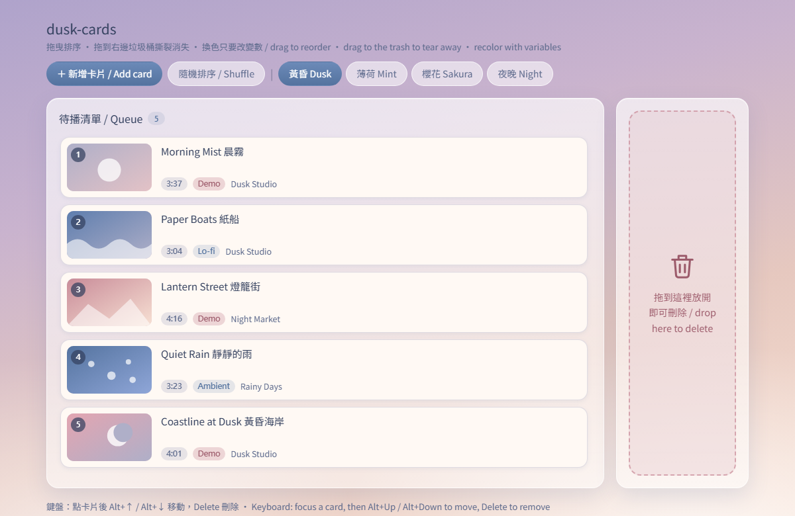
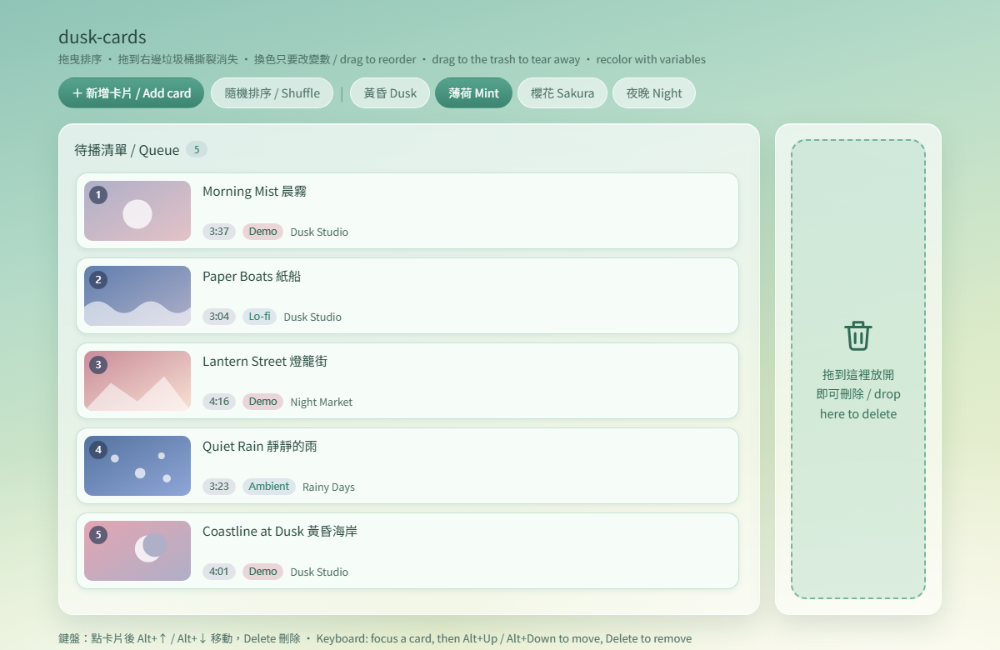
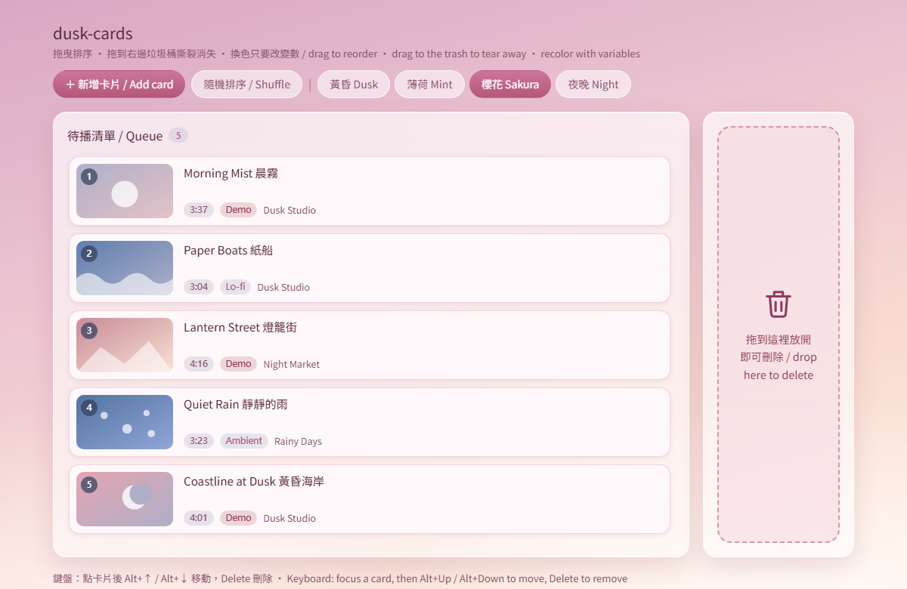
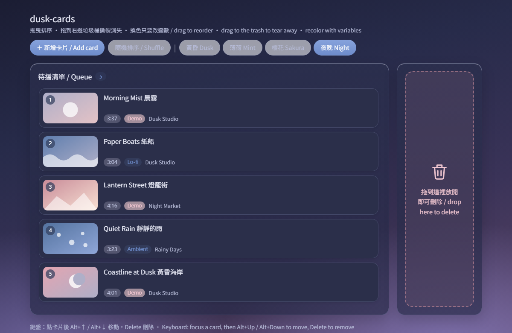

# dusk-cards

## 卡片式 UI 庫：拖曳排序、拖到垃圾桶撕裂消失、換色只要改變數

原生 JavaScript + CSS， [SortableJS](https://github.com/SortableJS/Sortable) 處理拖曳
從 [discord-music-bot](https://github.com/ZmeyEE/discord-music-bot) 的網頁看板抽出來的，因為真的很好看，所以獨立成一個庫 O_O 嘿嘿



<table>
  <tr>
    <td></td>
    <td></td>
    <td></td>
  </tr>
  <tr><td align="center">薄荷 Mint</td><td align="center">櫻花 Sakura</td><td align="center">夜晚 Night</td></tr>
</table>

試玩：用瀏覽器開 `demo/index.html`

## English summary

A tiny card-style UI kit in plain JavaScript + CSS: **drag to reorder**, **drag a card to the trash and it tears in two**, and **recolor everything by overriding CSS variables**.
No framework and no build step, [SortableJS](https://github.com/SortableJS/Sortable) does the dragging. Extracted from the dashboard of
[discord-music-bot](https://github.com/ZmeyEE/discord-music-bot). Public domain ([Unlicense](LICENSE)).
Developer guide in English: [docs/DEVELOPING.en.md](docs/DEVELOPING.en.md).

## 特色

- **拖曳排序**：卡片可以上下拖，序號自動重排
- **撕裂刪除**：拖垃圾桶，卡片在放開滑鼠時會撕成兩半飄走（更改 transform and opacity）
- **改變數換色**：全部顏色都是 `--dc-*` ，附 4 組範例（黃昏、薄荷、櫻花、夜晚）
- **鍵盤控制**：Alt+↑ / Alt+↓ 移動，Delete 刪除
- **安全**：標題等文字使用 textContent
- **效能**：卡片獨立 contain
- 約 23 KB 的 JS 和 11 KB 的 CSS 讚讚讚

## 快速開始

```html
<link rel="stylesheet" href="src/dusk-cards.css">
<script src="vendor/Sortable.min.js"></script>   <!-- 要先載入 / load this first -->
<script src="src/dusk-cards.js"></script>

<body class="dc-sky">                            <!-- dc-sky = 黃昏背景（選用）/ the dusk background (optional) -->
  <div id="board"></div>
  <div id="trash"></div>                         <!-- 刪除區（選用）/ trash zone (optional) -->
  <script>
    const board = DuskCards.createBoard("#board", {
      items: [
        { id: 1, title: "Morning Mist", thumbnail: "mist.jpg", duration: 217, tags: [{ text: "Demo", tone: "rose" }], meta: ["Dusk Studio"] },
        { id: 2, title: "Paper Boats", duration: 184 },
      ],
      trash: "#trash",
      onReorder: ({ id, from, to, items }) => console.log("moved", id, from, "→", to),
      onRemove:  ({ item, reason }) => console.log("removed", item.title, reason),   // reason: trash | button | keyboard | api
      onAction:  ({ name, item }) => console.log(name, item.title),                  // 預設有 play 按鈕 / a play button by default
    });

    board.add({ id: 3, title: "New card" });     // 新增 / add
    board.move(3, 0);                            // 移到最前面 / move to the front
    board.remove(2);                             // 移除（不播撕裂）/ remove (no tear effect)
  </script>
</body>
```

## API

### `DuskCards.createBoard(container, options)`

`container` 可以是元素或選擇器，回傳 board 物件 / an element or a selector, returns a board object

| 選項 / Option | 說明 / Description |
| --- | --- |
| `items` | 初始卡片陣列，格式見下 / initial cards, format below |
| `trash` | 刪除區（元素或選擇器），拖進去就刪除、撕裂 / trash zone (element or selector), drop a card there to delete and tear it |
| `numbered` | 顯示序號徽章，預設 `true` / show the number badge, default `true` |
| `actions` | 懸停按鈕，預設 `[play, remove]`，格式 `{ name, label, icon }`，名稱 `remove` 內建會撕裂並移除 / hover buttons, `remove` is built in |
| `labels` | 文字：`{ empty, trash, play, remove }`，要翻譯就改這裡 / texts, translate here |
| `icons` | 自訂圖示，`{ 名稱: "<path .../>" }`（24×24 的線條圖示）/ custom icons as SVG markup |
| `sortable` | 額外傳給 SortableJS 的設定 / extra options passed to SortableJS |
| `onReorder` | `({ id, from, to, items })` 順序改變 / order changed |
| `onRemove` | `({ item, items, reason })` 卡片被移除 / a card was removed |
| `onAction` | `({ name, item })` 按了其他按鈕 / another button was pressed |

### 卡片資料 / item

| 欄位 / Field | 說明 / Description |
| --- | --- |
| `id` | 必填，不能重複 / required, must be unique |
| `title` | 標題（純文字）/ title (plain text) |
| `thumbnail` | 縮圖網址，載入失敗會換成音符圖示 / image URL, falls back to a note icon when it fails |
| `duration` | 秒數（顯示成 `m:ss`）或任意文字（例如 `"live"`）/ seconds (shown as `m:ss`) or any text |
| `tags` | `[{ text, tone }]`，`tone` 可以是 `"rose"`、`"steel"` 或不填 / small pills |
| `meta` | `["文字", ...]` 標籤列後面的小字 / small text after the pills |

### board 的方法 / methods

| 方法 / Method | 說明 / Description |
| --- | --- |
| `add(item, index?)` | 新增卡片，id 重複會丟錯 / add a card, throws on a duplicate id |
| `remove(id)` | 移除（不播撕裂，`reason` 是 `"api"`）/ remove without the tear effect |
| `move(id, to)` | 移到指定位置 / move to a position |
| `setItems(items)` | 整批換掉，只動有變的卡片 / replace everything, only touching what changed |
| `getItems()` | 目前順序的資料 / the items in their current order |
| `destroy()` | 解除所有事件並清空 / remove every listener and empty the container |

另外還有 `DuskCards.createCard(item, opts)`（只做出一張卡片的 DOM）、`DuskCards.tearAway(node, { delay, rect })`（單獨使用撕裂特效）、`DuskCards.formatDuration(sec)`

## 換色

顏色全部是 `:root` 上的 `--dc-*` 變數，覆蓋就好，不用改函式庫
想只改某一塊，把變數寫在那個容器上也可以

```css
:root[data-theme="mint"] {
  --dc-accent: #3C8570;   --dc-accent-light: #56A38D;   --dc-card: #F6FCF8;
  --dc-ink: #24443C;      --dc-ink-2: #4C6E64;          --dc-rose-deep: #6FAE8F;
  --dc-sky-1: #8FC4B6;    --dc-sky-2: #B5DBC8;          --dc-sky-3: #DCEBC9;   --dc-sky-4: #F4F3D8;
}
```

| 變數 / Variable | 用在哪 / Used for |
| --- | --- |
| `--dc-cream` `--dc-rose` `--dc-lavender` `--dc-steel` | 調色盤（縮圖底色、重點色）/ the palette |
| `--dc-ink` `--dc-ink-2` `--dc-ink-3` | 主要／次要／輔助文字 / text levels |
| `--dc-accent` `--dc-accent-light` | 按鈕、重點 / buttons, highlights |
| `--dc-rose-deep` `--dc-rose-ink` | 刪除、粉色標籤 / delete color, rose pills |
| `--dc-card` `--dc-line` | 卡片底色與邊線 / card background and border |
| `--dc-shadow-rgb` | 陰影顏色（只放 `r, g, b`）/ shadow color |
| `--dc-sky-1` … `--dc-sky-4` `--dc-glow` | `.dc-sky` 背景的四個顏色與雲的光暈 / background colors and cloud glow |
| `--dc-panel-top` `--dc-panel-bottom` `--dc-panel-line` | `.dc-panel` 霧面面板 / the frosted panel |
| `--dc-trash-bg` `--dc-trash-bg-active` `--dc-trash-border` | 刪除區 / trash zone |
| `--dc-radius` `--dc-thumb-width` | 卡片圓角、縮圖寬度 / card radius, thumbnail width |
| `--dc-font` `--dc-font-num` | 字體 / fonts |

`dc-sky` 和 `dc-panel` 只是附贈的背景與面板，不想用就不要加 class

## 相容性與限制

- 要先載入 SortableJS（`vendor/Sortable.min.js` 是 1.15.6）
- 需要支援 Web Animations、`clip-path`、`aspect-ratio`、`contain` 的新版瀏覽器，目前只在 Chrome 測過，其他瀏覽器理論上可以，歡迎回報
- 目前是垂直清單，其他方向（橫向、格狀）沒有測過
- 還沒有 React / Vue 包裝，可以在元件掛載時 `createBoard`，卸載時 `destroy`
- 觸控：拖曳要先按住一下（80 ms）避免誤觸捲動，作者主要用滑鼠測試，觸控還需要更多回饋

## 測試

```bash
python test/run.py
```

用無頭 Chrome 開 `test/index.html`，跑 API、鍵盤、安全（標題不會變 HTML）、銷毀等檢查，拖曳本身需要真的滑鼠操作，請用 demo 手動試

## 授權

[Unlicense](LICENSE)（公有領域），想怎麼用、怎麼改、商用都可以，不用署名，畢竟 AI 協作署名啥地就算了 o_o <br>
第三方元件見 [THIRD_PARTY.md](THIRD_PARTY.md)
